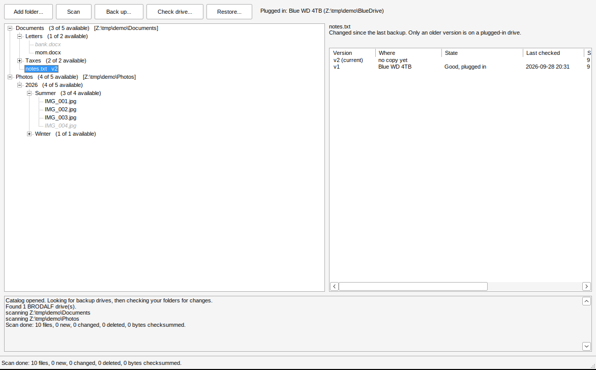
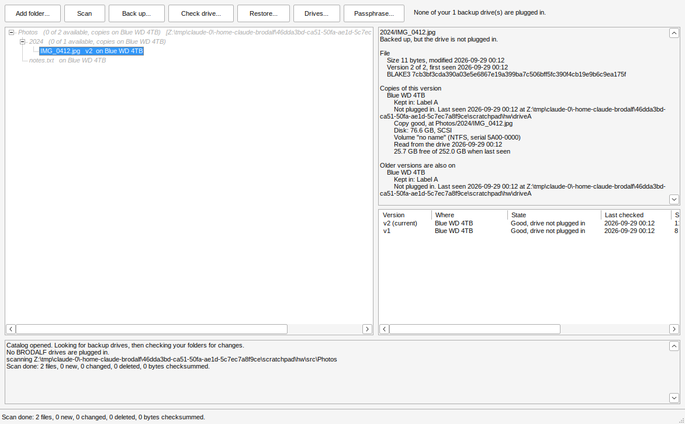
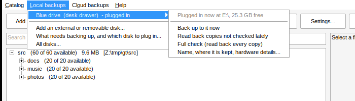
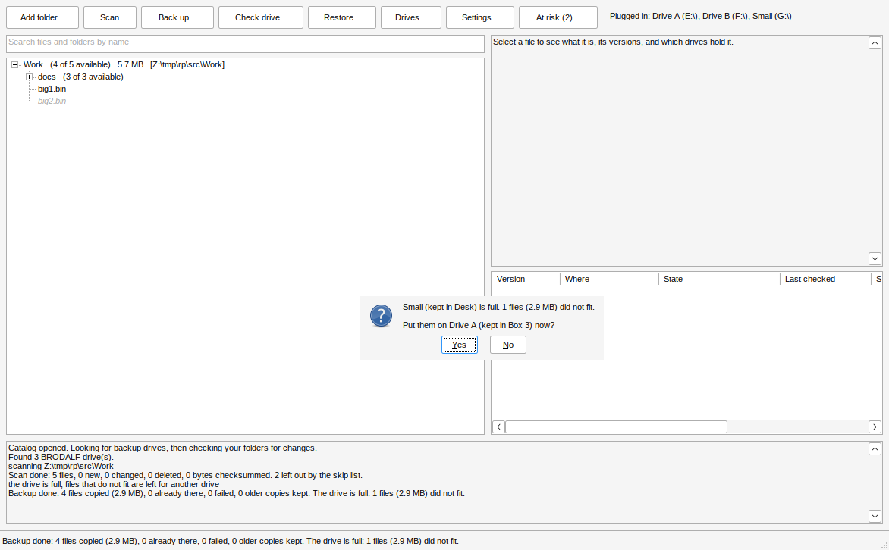
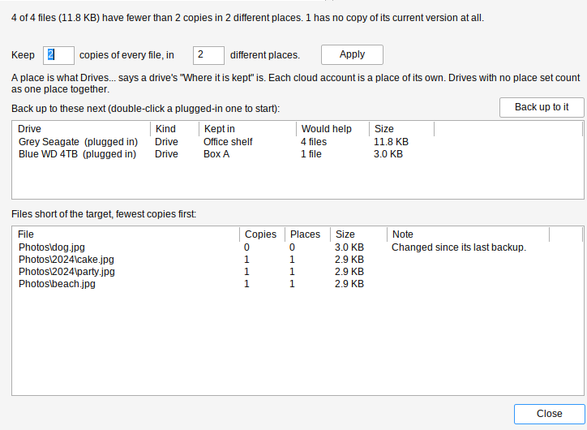
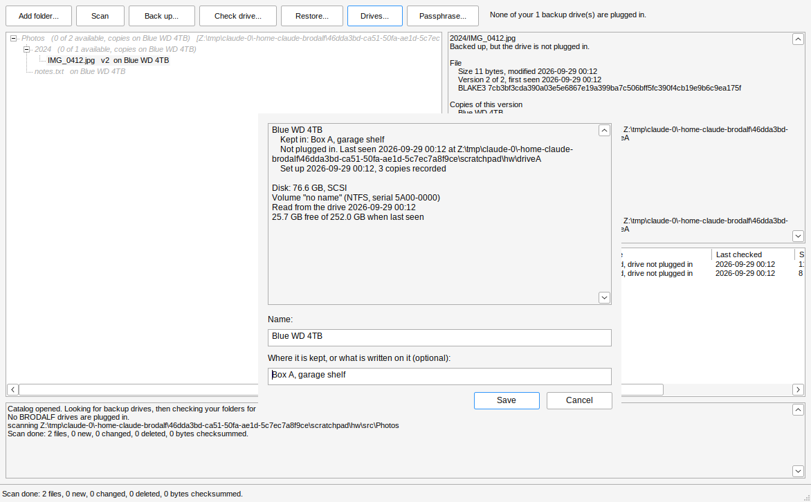
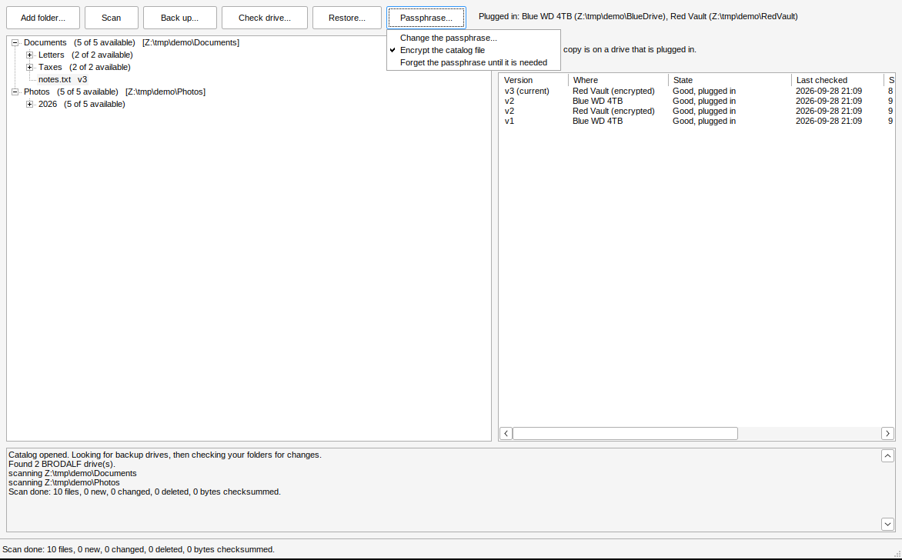

# BRODALF

BRODALF keeps track of what has been backed up, and to where, from your
original folders. It is built for backups on external and removable disks
that spend most of their time unplugged in a drawer.

The **database** (a `.brodalf` file, also called the catalog) holds no file
data. It records every file and folder in your **backup roots** (the folders
you chose to back up, as many as you like), every version BRODALF has seen,
its checksum, and every drive a copy of each version was written to. In the
app, files stay greyed out until BRODALF can see a correct copy on a drive
that is plugged in right now.

On the drives, copies are plain files and folders you can open in Explorer.
BRODALF never overwrites, moves or deletes anything it wrote to a drive, and
it writes nothing on your own files or folders.

See [docs/DESIGN.md](docs/DESIGN.md) for the design.

## Status

Version **0.8.0**, on the `four-features` branch and not released yet;
the latest release is 0.7.0 (2026-11-25), which reworked BRODALF to match
the owner's answers to 178 yes/no questions about what it should do. 0.8.0
adds four things the owner picked from what 0.7.0 left for later: tabs in
the window, starred files copied to extra places, encrypting only the
folders you choose, and backing up to several drives at once; see
[History](#history). Builds are on the
[Releases](https://github.com/Phawx/BRODALF/releases) page: an installer
that needs no administrator rights, and a zip with the two exes. Both are
unsigned, so SmartScreen warns.

The C core library, the Windows app (`brodalf.exe`) and a command-line tool
(`brodalf-cli`) work, with optional encryption. **Everything new since 0.5.0
has only been built and tested off Windows** (Linux tests; the MSVC build in
CI). See [Open items](#open-items-what-still-needs-trying-on-a-real-windows-pc).

**0.3.0 was the first build tried on a real Windows PC** (2026-10-04): the
whole loop of scanning, backing up to a USB stick, checking, changing and
renaming files, keeping old versions and restoring worked first time.

The screenshots below are from 0.5.0 and older; the window has changed
since, and 0.8.0 puts it in tabs.

## Build

You need CMake 3.16+ and a C compiler. Everything else is bundled in
`third_party/`.

```sh
cmake -S . -B build
cmake --build build --config Release
ctest --test-dir build -C Release
```

On Windows this works with Visual Studio (open the folder, or use the commands
above from a Developer Prompt) or MinGW-w64. To build a Windows `.exe` from
Linux:

```sh
cmake -S . -B build-win -DCMAKE_TOOLCHAIN_FILE=cmake/mingw-w64-x86_64.cmake
cmake --build build-win
```

## The Windows app



### Opening a database

Run `brodalf.exe`, or double-click a `.brodalf` file after associating it.
BRODALF offers the database you used last. Until one is open, the buttons
and the **Tools** menu are greyed out, and **File** has:

- **New database...**: first a checklist of the folders to back up (add as
  many as you like), then where to save the `.brodalf` file.
- **Open database...**
- **Recover the database from a backup drive...**: for a new PC or a lost
  database. BRODALF looks on every drive for its database copies, offers the
  newest, and asks where to save it. Plug a backup drive in first, or point
  it at a folder.

Opening a database starts a scan of the backup roots straight away. **That
scan is the one thing BRODALF starts by itself**, because a backup is only
as good as the last scan. If a backup root is not where the database says
(a new PC, another drive letter), BRODALF asks where it is now. If you
cannot find it, it offers to restore it from your backup drives instead,
and says which drives to plug in.

### The main window

Along the top are the buttons **Add backup root**, **Scan now**, **Back
up**, **Check drive**, **Restore**, **Drives**, **Settings** and **At
risk**. Beside them, one line says, for each drive that is plugged in, what
a backup to it would copy right now, or that it is up to date, and how
your extra places stand. Under them, one bar per full copy of your backup
roots: copy 1 is done when every file has at least one good copy, copy 2
when every file has two, and so on up to the number of copies you want.

The rest of the window is six tabs. BRODALF opens on the tab you used
last, and **View** lists them too.

- **Primary Database**: the tree of everything in your backup roots, the
  search box and the details of what is selected (below).
- **Next backup**: what the next backup copies, as a table.
- **Local backups**: every drive BRODALF knows, plugged in or not.
- **Starred files and extra places**: see
  [Starred files and extra places](#starred-files-and-extra-places).
- **Encryption**: see [Encryption](#encryption).
- **Restore**: see [Restoring](#restoring).

Each tab has its own buttons for everything it shows, so nothing needs a
menu.

**Primary Database.** The tree shows everything in your backup roots.
Greyed files have no copy on a drive that is plugged in (the label says
which drive holds them, if any). Amber files have changed, and only an
older version is reachable. Red means a copy is missing or damaged, and
struck-through means deleted from your folder. Starred files and folders
show **★ starred** after their name, and ones you chose to encrypt show
**[encrypted]**. Folders show how many files inside are available. Select a
file to see every version and where each copy is, even when none of those
drives are plugged in, so you know which box to go and get. The buttons
add a backup root, star or encrypt what is selected, run the bit-rot scan,
change where a root is, change what to leave out, list the deleted,
damaged, in-use and largest files, and export the list as CSV.



**Next backup.** Pick a drive, an extra place, or **Any drive**. The table
lists the files the next backup would copy there (for Any drive: every
file short of the copies you want), with its size, whether that drive
already holds an older version of it, a column for each full copy saying
whether the file has it yet, how many copies and places it has, and
whether it is starred or encrypted. The buttons back up to that drive or
to every plugged-in drive, list the files changed on it, and say which
drive to plug in.

**Local backups.** One row per drive: whether it is plugged in, its size
and free space, how much of it is BRODALF's copies and how much other
files, the space kept free, its health (SMART, temperature, hours powered
on and SSD wear, where the disk passes them through), its oldest
read-back, its copies and its problems. The buttons set up a disk, back up
to the selected drive or to every plugged-in one, check it, open it in
Explorer, list what changed since its last backup, change its name and
where it is kept, mark it lost or broken, show where every drive stands
and say which drive to plug in. **Back up to several drives at once** is
here too (see [Backing up](#backing-up)).

Below the tabs, BRODALF shows the **job** that is running (scan, backup,
check or restore), with how many files and how much data, the data rate
and a **Stop** button, then the **file** being copied or read right now,
then the log.

The menus are **File** (new, open, recover the database, the recovery
sheet, CSV export, exit), **View** (the six tabs, the status of every
drive, files at risk, the largest, deleted, damaged and in-use files, the
files the last restore left alone, Refresh), **Tools** (add a backup root,
scan, the bit-rot scan, change where a root is, back up, back up to every
plugged-in drive, check a drive, restore, set up a disk, add an extra
place, star or encrypt what is selected, every drive and extra place BRODALF
knows with its own submenu, and Settings) and **Help**. Right-click a file
or folder in the tree to open it in Explorer, restore it, star it or
encrypt it; right-click a backup root to stop or resume backing it up,
change what it leaves out, or say where it is now; right-click a version to
restore just that version or open its copy on the drive.



### Nothing else starts by itself

Apart from the scan when a database opens, BRODALF does what you press, and
only then. It schedules nothing, does not back up or check a drive because
it was plugged in, and does not care what else runs on the PC. When a drive
is plugged in it reads only the drive's `BRODALF.media` file, its free space
and its health data, so the tree can show what is reachable. A plugged-in
drive that is due for a check offers one, which you can turn down. Close
BRODALF and nothing of it runs.

By default a running job lets other programs come first, so the PC stays
usable (**Settings > Let other programs come first while a job runs**).

### Backing up

Press **Back up** and pick a plugged-in drive, or **All N of them** to back
up to every plugged-in drive. A backup copies everything that drive does
not hold yet, as the last scan found it. It does not ask first: the line
beside the buttons and the **Next backup** tab already say what it will
copy. If a file
changed since the scan, BRODALF reads it again and copies what is there now.
If nothing has been scanned yet, it offers to scan first; if you stop a
scan, it says that a backup now works from what the scans so far found, and
asks you to scan again when you can.

Nothing on a drive is ever overwritten, moved or deleted. Files go under
`BRODALF\<database id>\<backup root>\<path>`. When a file changes, the new
version goes alongside the old copy, under `.versions\<backup root>\...\`
as `name.v2.ext`, `name.v3.ext` and so on. Each copy is written under a
temporary name, checked against its checksum, flushed to the drive, and only
then given its real name, so a cut-off copy never looks like a real
one. A file whose checksum has not changed is never copied again, whatever
its date.

If many of the files whose copies on that drive were up to date have
changed at once, BRODALF stops and asks first, since that is what
ransomware encrypting your files looks like. **Show the changed files**
lists them; **Back up anyway** goes ahead, and the copies already on the
drive stay as they are.

A backup never fills a drive to the last byte: it leaves room for the
database's own copies (512 MB by default; **Settings > Space kept free on
each drive**). Files that don't fit wait for another drive, and each drive
gets whatever it is missing, so a big folder spreads across as many drives
as it needs. At the end of every backup, a copy of the database goes onto
the drive as `catalog-r<revision>.brodalf`, next to the older ones.



### Backing up to several drives at once

With two or more drives plugged in, **Back up to every plugged-in drive**
backs up to each of them, one after another, as it starts. Tick **Back up
to several drives at once** (on the **Local backups** tab or under
**Settings**) and BRODALF instead reads each file once and writes it to all
the drives at the same time. That is quicker, but the PC works harder
while it runs: the USB ports, memory and processor are shared by every
drive at once, so other programs may be slower, and the backup goes at the
pace of the slowest drive. BRODALF says so before it turns the option on.
A drive that fails to write a file does not stop the others.

### Starred files and extra places

Star the files and folders that matter most (**Star it** on the **Primary
Database** tab, or right-click in the tree). Starred files are backed up to
your drives like every other file, and also to your **extra places**: a
second, secondary kind of backup, such as your Dropbox, OneDrive or Google
Drive folder on this PC, a network share or a folder on another disk.

Add one on the **Starred files and extra places** tab with **Add an extra
place**: pick the folder and describe it well enough to tell it apart
later, in at least two words (like "Dropbox folder on the laptop"); BRODALF
refuses a description that is too short. You can give it a size limit, so
a small free account does not fill up, and have every copy there
encrypted. Back up to it like a drive (**Back up starred files to it**).
Only starred files go there, plain files in their folders, and nothing
there is overwritten, moved or deleted either.

BRODALF only copies files into the folder; it talks to no cloud service,
and the folder's own app does any syncing. Copies in an extra place can be
restored, but they never count toward the copies you want or the full
copies, and BRODALF never suggests plugging one in to get there. The tab
lists what is starred, and for each extra place whether it is found now,
its limit, how many starred files are there as they are now, what is
waiting, what would go past the limit and the space it uses.

A scan leaves out BRODALF's own copies when an extra place sits inside a
backup root (a Dropbox folder in your home folder, say), so they are not
backed up again as new files.

### Full copies and files at risk

You choose how many copies of every file you want, in how many places (by
default **2 copies, in 2 places**). A place is what a drive's "where it is
kept" says (so "Box A" and "Office shelf" are two places), and drives with
no place set count together as one. A copy counts when BRODALF last saw it
good, whether or not the drive is plugged in right now.

The **At risk** button shows how many files fall short. It opens a list of
those files, fewest copies first, and the drives that would help most, with
where each is kept. **Which drive to plug in** on the **Next backup** and
**Local backups** tabs says the same in one go. **View > Largest files**
lists the biggest files, which BRODALF backs up like any other.



### Drives

A drive is recognised by the `BRODALF.media` file on it, not by its letter.
When a disk BRODALF does not know is plugged in, it asks whether to set it
up as a backup drive: **Set it up as a backup drive**, **Not now**, or **Never ask about
this disk**. Setting it up makes BRODALF's own folder on it and touches nothing
else on the disk.

Each time a drive is plugged in BRODALF reads what the disk says about
itself and keeps the latest reading in the database: make, model, serial
number, firmware, bus and size; the volume name, serial and file system;
and SMART health (the drive's own failure prediction, temperature, hours
powered on, power cycles, bad sectors and SSD wear), where the disk passes
it through. Every drive can also have a free-text **where it is kept**
label, such as "Box 3, garage shelf".



**Drives** (or a drive's submenu under **Tools > Backup drives and extra
places**) shows where each drive stands, from the database alone, so it
works with the drive in a box: what it holds, what changed since, its last
backup and check, copies found missing or damaged, and its total, free and
kept-free space. **View > Status of every drive** puts every drive in one
table, and the **Local backups** tab shows them all as a list. **File >
Export the file list (CSV)** writes every file and the drives holding it,
for a spreadsheet.

A drive that is lost or broken can be marked so (**Mark it lost or
broken**). BRODALF first shows what that does to each full copy; once
marked, its copies stop counting, and what it held is backed up again to
the other drives. If it turns up again, **Found it** makes its copies count
again.

### Checking a drive

Checksums are what BRODALF trusts, not file names or dates. **Check drive**
reads the copies on a plugged-in drive and compares each one's size, time
and checksum. It offers two choices:

- **Check every copy**: reads every copy. Takes a while on a big drive.
- **Read back copies not read lately**: the copies not read back in the
  last 30 days, and new ones, so a full check can be spread over time.

When a plugged-in drive's oldest read-back is older than **Settings > A
plugged-in drive offers a check after** (6 months by default), BRODALF
offers a check. A copy found damaged is written again by the next backup to
that drive, alongside the damaged one.

### Deleted, damaged and in-use files

When a scan finds files gone from your backup roots, BRODALF says so and
offers **View > Deleted files**, where you can keep tracking them (they
stay in the database, with the drives that still hold them) or forget them.
Forgetting changes the database only; their copies stay on the drives.
Nothing is ever dropped from the database without your say.

**Tools > Bit-rot scan** reads every file again, including ones whose
size and time did not change. A file whose checksum changed anyway is
usually damage on this PC's disk, and the copies on your drives are the good
ones. **View > Damaged files** lists them, to restore from a drive or to
keep as they are now.

A file another program holds open cannot be read, so a scan or backup skips
it and lists it at the end. **View > Files that were in use** shows the
list again.

### Backup roots

Add as many backup roots as you like. A root can be **stopped** (right-click
it): it is not scanned or backed up any more, but its files stay in the
database and their copies still restore. **Back up this root again** resumes
it. If a root moves (a new PC, another drive letter), **Tools > Change
where a backup root is** records the new place in the database; nothing on
the drives moves. To back up a different set of folders, make another
database: any number of databases can cover the same folders, each on its
own.

### What to leave out

Scans skip temp files, caches and things a program can rebuild, such as
`*.tmp`, `~$*` Office lock files, `Thumbs.db`, `$RECYCLE.BIN`,
`node_modules`, `__pycache__` and `.cache`. There are two lists: one for
every backup root (**Settings > What to leave out in every backup root**)
and one per root (right-click it). One pattern per line, `*` and `?` as
wildcards, a trailing `/` for folders only, and a `/` in the middle (like
`Photos/Exports/`) for a path inside a backup root. A file that is newly
left out shows among the deleted files, for you to keep or forget.

Files in OneDrive or Dropbox are scanned like any other; one that is
online-only (in the cloud, not on this PC) is left alone until it is on the
PC. Symbolic links and junctions are left out.

### Restoring

Select a file or folder and press **Restore**, or use the **Restore** tab,
which restores what is selected, everything or the deleted files, shows
which drives a restore needs, and carries on one that waits for a drive.
Restoring one backup root
puts its files straight into the folder you choose; restoring several gives
each its own folder there. **Nothing in the destination is overwritten**: a
file already there with the right contents is skipped, and one that differs
is left alone and listed on the **Restore** tab, with the backed-up and the
existing file's size and modified time side by side, and which is newer.

When the files live on several drives, BRODALF first shows which drives it
needs, in order, with where each is kept, and restores what the plugged-in
drives hold. Plug in the next drive and restore again for the rest.
**Restore deleted files** brings back deleted files as they were
last seen, and right-clicking a version restores just that one.


### Encryption

Encryption is optional, and nothing is encrypted unless you choose it.
There are four kinds, each on its own, all on the **Encryption** tab:

- **An encrypted drive**: tick **Encrypt the files on this drive** when you
  set up a new drive (or an extra place). Every copy on it is encrypted.
  Each drive is plain or encrypted from the day it is set up.
- **Encrypted folders**: pick files or folders (**Encrypt it** on the
  Primary Database tab, or **Choose a folder to encrypt**). Their copies
  are encrypted on every drive and extra place, also the plain ones, and
  everything else stays plain files. Copies made before stay as they are,
  since nothing on a drive is overwritten; new copies and new versions are
  encrypted. **Stop encrypting it** makes the next new copies plain again.
- **The database file itself** (**Encrypt the database file**).
- **The database copies on the drives**, which are always encrypted on an
  encrypted drive.

The first time, BRODALF asks you to choose a passphrase. File contents are
encrypted (XChaCha20-Poly1305, key from Argon2id), while file and folder
names stay readable so you can still find things in Explorer. Encrypted
copies end in `.bdenc`. The tab also changes the passphrase, makes BRODALF
forget it until it is needed, makes a new recovery key and prints the
recovery sheet (**File > Print a recovery sheet**), which lists your drives
and a recovery key that opens your encrypted copies if the passphrase is
lost.

**What it costs in time.** BRODALF measures how fast this PC encrypts and
says what that means, for everything you chose and for each folder in the
list. Encrypting runs while each copy is written, so on a USB hard drive a
backup takes about as long as before; on a fast SSD, or a slow PC, it can
take longer, and the tab says how much. Checking and restoring an encrypted
copy decrypt it at about the same speed. Encrypted copies take about 0.1%
more space.

**Write the passphrase down somewhere safe.** Without it, nobody can read the
encrypted copies, including you.

Hiding file and folder names is left for later.



### Search

Type in the box above the tree to find files and folders by name anywhere
in your backup roots (every word must match, so `party 2024` works). Each
result shows whether it is available and which drives hold it, with where
each drive is kept. Double-click a result to go to it in the tree.


### When something goes wrong

BRODALF keeps a log in `%LOCALAPPDATA%\BRODALF\brodalf.log` (the older
part moves to `brodalf.log.old` past about 1 MB). When a job stops with an
error, the database cannot be saved or opened, or the app crashes, BRODALF
shows the error and saves a report to
`%LOCALAPPDATA%\BRODALF\reports\brodalf-error-<date>-<time>.txt`. The
report starts with instructions for posting it as a new issue at
https://github.com/Phawx/BRODALF/issues, then gives the error, the BRODALF
version and build, the Windows version and the end of the log. Your user
name, computer name, email addresses and sign-in tokens are replaced before
the file is written. Nothing is sent anywhere. The command line does the
same, printing where the report went.

## Try it from the command line

```sh
brodalf-cli new   family.brodalf "C:\Users\me\Pictures"   # a database with its backup roots
brodalf-cli scan  family.brodalf
brodalf-cli tree  family.brodalf                      # everything greyed out
brodalf-cli drive family.brodalf E:\ "Blue WD 4TB" --location "Box 3"
brodalf-cli preview family.brodalf E:\                # what a backup would copy, doing none of it
brodalf-cli backup family.brodalf E:\
brodalf-cli sets   family.brodalf                     # progress toward each full copy
brodalf-cli tree  family.brodalf --drive E:\          # backed-up files light up
brodalf-cli versions family.brodalf Pictures "2024/IMG_0412.jpg" --drive E:\
brodalf-cli check family.brodalf E:\                  # read every copy back
brodalf-cli verify family.brodalf E:\                 # only copies not read back in 30 days
brodalf-cli restore family.brodalf D:\restored --drive E:\

brodalf-cli drive family.brodalf F:\ "Red Vault" --encrypt --location "Label A"
brodalf-cli drives family.brodalf                     # make, model, serial, health, where kept
brodalf-cli status family.brodalf                     # where each drive stands
brodalf-cli drive-lost family.brodalf "Red Vault" broken   # its copies stop counting
brodalf-cli encrypt-catalog family.brodalf on
brodalf-cli passphrase family.brodalf                 # change it

brodalf-cli target  family.brodalf 2 2                # 2 copies of everything, in 2 places
brodalf-cli at-risk family.brodalf                    # what falls short, and which drive to plug in
brodalf-cli need    family.brodalf                    # what needs backing up, and the drive to plug in
brodalf-cli search  family.brodalf party 2024         # find a file and the drive (and box) holding it
brodalf-cli deleted family.brodalf --new              # files gone since you last looked
brodalf-cli deleted-ack family.brodalf --all          # keep tracking them
brodalf-cli scan    family.brodalf --bitrot           # find files damaged on this PC
brodalf-cli skip    family.brodalf --root Pictures --add "Exports/"   # leave a folder out of one root
brodalf-cli root-move family.brodalf Pictures "D:\Pictures"           # the root is somewhere else now
brodalf-cli restore-plan family.brodalf --root Pictures --dest D:\restored   # which drives, in which order
brodalf-cli restore family.brodalf D:\restored --deleted --drive E:\    # deleted files, as last seen
brodalf-cli option  family.brodalf reserve_mb 1024    # keep 1 GB free on every drive
brodalf-cli recover E:\ F:\ D:\new.brodalf            # start again from the newest database copy
brodalf-cli export  family.brodalf files.csv          # every file and its drives, for a spreadsheet

brodalf-cli backup  family.brodalf E:\ F:\ --parallel  # both drives at once, each file read once
brodalf-cli pending family.brodalf "Blue WD 4TB"      # what the next backup to that drive copies
brodalf-cli star    family.brodalf Pictures 2024      # star a folder
brodalf-cli place   family.brodalf "C:\Users\me\Dropbox" "Dropbox folder on the laptop" --limit 2GB
brodalf-cli backup  family.brodalf "C:\Users\me\Dropbox"   # starred files to the extra place
brodalf-cli places  family.brodalf                    # how each extra place stands
brodalf-cli encrypt-folder family.brodalf Pictures Taxes   # only that folder's copies are encrypted
brodalf-cli encrypted-folders family.brodalf          # what is encrypted, and what it costs in time
```

The command line starts nothing by itself: each command runs once, when you
run it (it does not scan on open, unlike the app). Ctrl+C stops a long one
between files and keeps what it finished. `--json` prints a command's result
as JSON.

Passphrases are asked for on the terminal, or read from `BRODALF_PASSPHRASE`
(and `BRODALF_NEW_PASSPHRASE` when setting one).

## Layout

| Path | What |
| --- | --- |
| `include/brodalf.h` | Public API of the core library |
| `src/catalog.c` | The `.brodalf` file format and schema |
| `src/scan.c` | Scanning backup roots, versions, moves, the bit-rot scan |
| `src/media.c` | Drive IDs, connecting drives, lost and broken drives, checks and read-back |
| `src/backup.c` | Backup (never overwriting), restore, one version restored |
| `src/crypto.c` | Passphrase, master key, encrypted file streams |
| `src/store*.c`, `src/store.h` | Storage interface: local drives and folders |
| `src/query.c` | Ghost-tree state, deleted files, search |
| `src/risk.c` | Full copies, files at risk, which drive would help, space tracking |
| `src/marks.c` | Starred files, extra places, encrypted folders and what they cost |
| `src/status.c` | Where each drive stands, CSV export |
| `src/drive_hw.c` | Disk make, model, serial and SMART health |
| `src/recover.c` | Finding database copies on drives, backup roots that moved |
| `src/sheet.c` | The recovery sheet |
| `src/report.c` | The app log and error reports |
| `src/platform_*.c` | Windows and POSIX file system layer |
| `gui/` | The Win32 app, `brodalf.exe` |
| `cli/main.c` | `brodalf-cli` |
| `tests/test_core.c` | End-to-end test |
| `tests/test_crypto.c` | Encryption test |
| `tests/test_blake3.c` | Checksum test vectors |
| `tests/bench_many.c` | Many files: timings and counts (`bench_many 1000000` by hand) |
| `installer/brodalf.nsi` | The NSIS installer |

## Third-party code

`third_party/` holds unmodified copies of
[SQLite](https://sqlite.org) 3.45.0 (public domain),
[BLAKE3](https://github.com/BLAKE3-team/BLAKE3) 1.5.4 (CC0 / Apache-2.0) and
[zstd](https://github.com/facebook/zstd) 1.5.6 (BSD, single-file build) and
[Monocypher](https://monocypher.org) 4.0.2 (CC0 / BSD-2-Clause).

## Where the project stands

This section is the hand-off: everything a person or a Claude Code session
on a local machine needs to pick the work up without the chat history.

### History

- The original BRODALF was a Rust tool (egui GUI, catalog in SQLite, BLAKE3
  hashes, copies to a local folder). It no longer compiled and had no cold
  storage, no versioning and no cloud. It was used as a reference only; the
  Rust source is not in this repo.
- Before that there was a Go/Fyne prototype. Its files were removed from
  the repo in 0.6.0 (they are in git history).
- On 2026-09-28 the design below was agreed and the C rewrite started
  (plain C11 + CMake, vendored dependencies). It landed as PR #1 the same
  day; everything since has gone straight to `master`.
- v0.2.0 was released 2026-09-29, v0.3.0 on 2026-10-04.
- On 2026-10-04 the released 0.3.0 was run on a real Windows 11 PC for the
  first time, against a USB stick; see
  [What the first real-PC test showed](#what-the-first-real-pc-test-showed).
- v0.4.0 (2026-10-07) took the OneDrive and Dropbox storage out again and
  fixed the four bugs below that the code review and that test turned up.
- v0.5.0 (2026-11-24): faster checksums (BLAKE3's SSE2/SSE4.1/AVX2/AVX-512
  paths), overlapped copies, hashing on several cores during a scan, fewer
  fsyncs; Stop for a running job; original modified times kept;
  case-insensitive paths on Windows (schema 6); every item of the
  2026-10-04 known-issues list fixed; backlog 1 to 6 built (recovery on a new
  PC, a recovery key, deleted files, replacing a drive, the recovery sheet,
  an installer); the scheduled check created through the Task Scheduler COM
  API so it runs on battery. None of it has run on a real Windows PC yet.
- v0.6.0 (2026-11-25): nothing starts by itself (owner's call, 2026-11-24).
  Taken out: the scheduled check (its task is removed), backing up and
  reading back when a drive is plugged in, the quick check on plug-in, the
  rescan on open, check reminders, a restore carrying on by itself, the
  ransomware guard and shadow copies. Added: a backup preview before Start
  (with a warning, and old versions kept, when many files changed at once),
  where each drive stands, a job history, a CSV export of the file list,
  online-only cloud files left alone, Ctrl+C in the command line.
- v0.7.0 (2026-11-25, built on the `reconcile-answers` branch first):
  the owner answered 178 yes/no questions about what BRODALF should do, and
  the build was reworked to match. Nothing on a drive is ever overwritten,
  moved or deleted (no pruning of old versions, no moves on the drive, no
  Replace drive); a new version goes alongside under `.versions`. A copy of
  the database goes on every drive as `catalog-r<revision>.brodalf`, never
  over an older one, with space kept free for it. The app scans when a
  database opens (the one automatic step), asks where a moved backup root
  is, and offers a restore when it cannot be found. New: backup roots that
  can be stopped and resumed, a skip list per root, deleted-files triage,
  the bit-rot scan and damaged-files list, lost and broken drives, progress
  toward each full copy, the largest files, restoring one version or the
  deleted files, restores that never overwrite and list what they left
  alone, recovering the database from the newest copy on any drive,
  `--json` output, and the File, Database, Local backups, Restore, View and
  Help menus with right-click menus. Taken out: the job history, restoring
  as of a date, `--continue-from`, the old-versions rule and quick checks
  (a check always compares size, time and checksum). Backups run at low
  priority by default. Releases are made only by hand.
- v0.8.0 (on the `four-features` branch, not released yet): the four
  features the owner picked from what 0.7.0 left for later. Tabs in the
  window (Primary Database, Next backup, Local backups, Starred files and
  extra places, Encryption, Restore), with the menus now File, View, Tools
  and Help. Starred files and folders, copied to extra places (a Dropbox
  or OneDrive folder, a network share) that must be described, can have a
  size limit and never count toward the copies wanted. Encrypting only the
  folders you choose, on every drive, with what it costs in time on this
  PC. Backing up to several drives at once, reading each file once, as an
  option that is off by default. A scan leaves out BRODALF's own copies
  inside a backup root. Schema 8. The command line gains `star`, `unstar`,
  `stars`, `place`, `place-limit`, `places`, `encrypt-folder`,
  `plain-folder`, `encrypted-folders`, `pending` and `backup` to several
  drives (`--parallel`).

### Design decisions (agreed 2026-09-28, still binding)

The owner's answers of 2026-11-25 (in the project's files as
`brodalf-answers.md`) refine these; where they differ, the answers win.

- **Not resident, and nothing automatic** (since 0.6.0, owner's call
  2026-11-24). BRODALF never runs in the background and schedules nothing.
  It does not care what else runs on the PC. The one exception (2026-11-25):
  opening a database starts a scan, since a backup is only as good as the
  last scan. Its point is keeping track of
  what has been backed up, and to where, from the original folders. The
  person chooses when to scan, back up, check and restore, and sees where
  each job and each drive stands. On open and on plug-in it only reads which
  drives are present, with their free space and health data. Free space per drive is recorded on plug-in and
  before and after every backup. A tray icon or always-on mode was rejected.
- **Checksums are the truth.** Whether data is safely held is decided by
  BLAKE3 checksums, everywhere: quick and full checks, read-back, move and
  rename detection.
- **Offline removable drives.** A drive is identified by the
  `BRODALF.media` file on it, never by its letter.
- **No cloud storage for now** (owner's call, 2026-10-07). OneDrive and
  Dropbox as secondary storage were built in 0.3.0 (OAuth with PKCE, tokens
  in Windows Credential Manager, app-folder access, chunked uploads) and
  removed in 0.4.0. The code is in git history at tag `v0.3.0`:
  `src/cloud.c`, `src/http_*.c`, `src/secrets.c`, `tests/test_cloud.c`,
  `tests/mock_cloud.py` and the cJSON dependency. A catalog written by
  0.3.0 that lists a cloud account still opens: the account is shown as
  unsupported, nothing can be backed up to it, and the copies it holds
  still count towards the number of copies you want, as a place of their own.
- **The catalog holds no file data**, only where the bits live. Old versions
  stay browsable on the drive in a `.versions` folder.
- **Encryption is optional**, and off unless chosen: per drive, per
  folder (since 0.8.0) and for the database file. It encrypts file
  contents only; file and folder names stay readable so a drive is still
  browsable.
- **Extra places are secondary** (since 0.8.0): a folder that gets a
  second copy of the starred files only. It must be described, its copies
  never count toward the copies wanted, and BRODALF talks to no cloud
  service.
- **Windows is the platform, the GUI is the interface**: native Win32 in C,
  with standard menus (File, View, Tools, Help), tabs for the database,
  the next backup, local backups, starred files, encryption and restoring
  (since 0.8.0), and a prominent progress area. POSIX builds exist for tests and the CLI. A
  cross-platform GUI waits until after 1.0.
- **Startup flow**: open BRODALF; until a database is open only New, Open
  and Recover are available. A new database asks for its backup roots first,
  then where to save the file. Opening one reads which drives are plugged
  in and scans the backup roots, and the ghost tree stays greyed out until a
  copy is verified on connected storage. Clicking an entry shows its
  details in a second pane.
- **A copy of the database goes onto each drive** at the end of every
  backup to it, as `catalog-r<revision>.brodalf`, never over an older copy
  (0.6.0 and older wrote `catalog-backup.brodalf`). Space is kept free on
  every drive so it always fits (512 MB by default).
- **Never overwrite, move or delete on a drive** (2026-11-25). Old versions
  are never pruned; a new version goes alongside the old under `.versions`.
  A moved file or root is recorded in the database only; the copy on the
  drive stays where it is. Restores never overwrite either.
- **Nothing is dropped from the database without the user's say**: deleted
  and newly left-out files are listed for the user to keep tracking or
  forget, and forgetting leaves the copies on the drives.
- **Ransomware**: before a backup, if many files changed at once, stop and
  ask, with the list of changed files (the automatic pause of 0.3.0 to 0.5.0
  was taken out in 0.6.0).
- **One database is one set of backup roots.** To back up a different set,
  make another database; databases are never merged, and BRODALF writes
  nothing on the files it backs up.

The original design write-up lives at
https://claude.ai/artifact/RMxcPVGY6unWn917nXnJ8w, but everything that
matters from it is in this section and in [docs/DESIGN.md](docs/DESIGN.md),
which describes the current implementation.

### How it is built and tested

- `cmake -S . -B build && cmake --build build && ctest --test-dir build`.
  Tests: `tests/test_core.c` (end to end, including the bit-rot and
  at-risk cases added in 0.4.0) and `tests/test_crypto.c` (about 50 s
  under ASan because of Argon2, 2 s in Release).
- CI is `.github/workflows/c-core.yml`: on every push to any branch it
  builds and tests on ubuntu-latest and windows-latest (MSVC), and uploads
  `brodalf.exe` and `brodalf-cli.exe` as the `brodalf-windows` artifact.
- `tests/bench_many.c` times a scan, a backup and a check of many small
  files and checks the counts; ctest runs it with a small number. On the
  Linux machine 0.7.0 was built on, 20,000 files: first scan about
  25,000 files/s, backup about 3,100 files/s, check about 68,000 files/s.
- Until 0.3.0, Windows testing was done from Linux: cross-compile with
  `cmake/mingw-w64-x86_64.cmake` (`gcc-mingw-w64-x86-64`) and run under
  `wine64` with `LANG=C.UTF-8`; GUI screenshots were taken with Xvfb,
  xdotool and ImageMagick. Note that the released zip is the MSVC build
  from CI, not the MinGW build that ran under Wine. Wine has no VSS, no real disk model or SMART data and no real plug-in
  notifications.
- Vendored in `third_party/`: SQLite 3.45.0, BLAKE3 1.5.4 (with its SSE2,
  SSE4.1, AVX2 and AVX-512 C files since 0.5.0), zstd 1.5.6
  (single file) and Monocypher 4.0.2. Nothing is downloaded at build time.

### Releasing

Releases are made only by hand, on the owner's word. Every push to any
branch builds and tests; nothing is published because of a push or a
version number. To ship: merge to `master`, set the version in
`CMakeLists.txt` (`project(brodalf VERSION x.y.z)`, and the VERSIONINFO in
`gui/brodalf.rc`), update `.github/release-notes.md`, then **Actions > C
core > Run workflow** on `master` with **release** ticked. That publishes
`vx.y.z`, if it does not exist yet, with the zip of the two exes plus this
README and THIRD-PARTY-NOTICES.txt, the NSIS installer built from
`installer/brodalf.nsi`, and the release notes. The exes are unsigned.

### What the first real-PC test showed

On 2026-10-04 the released 0.3.0 was run on a Windows 11 laptop with a
29 GB SanDisk USB stick (FAT32) as the drive, the protected folder inside
OneDrive, 13 bogus files (5.6 MB) with a `.tmp`, an empty file, a one-byte
file and an accented name among them. Everything in the loop worked first
time and no error report was produced:

- scan (12 files, the `.tmp` left out, nothing skipped as a link);
- setting up the drive and backing up (12 copies, all identical to the
  originals by SHA-256; `BRODALF.media` and `catalog-backup.brodalf` on
  the stick);
- the file details and **Drives...** with the real hardware: make, model,
  serial, firmware, bus, volume, free space and the "does not pass SMART
  through" note;
- a full check (12 good); editing, renaming and removing files, then
  backing up again (the old version under `.versions`, the renamed file
  moved on the drive instead of copied, the removed file kept);
- restoring the folder (identical to the source);
- the **At risk** window; closing (catalog saved, lock released).

Also seen: the first launch had
been left at the catalog chooser while a second was started, so two
instances ran at once (the lock file kept them apart). The four bugs fixed
in 0.4.0 came from the code review of the same day and this test:

1. OneDrive and Dropbox placeholder files carry the reparse-point
   attribute, and the scanner treated every reparse point as a link to
   skip (`src/platform_win32.c`). It did not bite in the test because the
   files were freshly created, but a synced folder could have gone
   entirely unprotected. Only name-surrogate reparse points (symbolic
   links, junctions) are links now.
2. A copy found damaged by a full check was marked good again by the next
   quick check when its size and time had not changed, which is what bit
   rot looks like (`src/media.c`). A copy found missing or damaged now
   stays so until a re-read matches its hash.
3. The shadow-copy helper (`brodalf.exe --shadow-copy`) was started after
   the GUI's `CoInitializeEx(COINIT_APARTMENTTHREADED)`, so VSS ran in a
   single-threaded apartment with a blocking wait, the classic hang. The
   helper now runs before COM is initialised (`gui/main.c`).
4. The **At risk** list said "changed since its last backup" for a file
   whose newest version was already backed up (`src/risk.c`).

### Open items: what still needs trying on a real Windows PC

1. Everything new in 0.8.0, none of which has run on Windows, and the
   window has not been looked at since the tabs went in: the six tabs and
   their buttons and tables, the File, View, Tools and Help menus, the tab
   remembered between runs; starring and encrypting from the tree, ★ and
   [encrypted] in the tree; adding an extra place (a real Dropbox or
   OneDrive folder, and a network share), its size limit and backing up
   to it; an encrypted folder on a plain drive, and the time it says
   encrypting takes against a real backup; backing up to two or more USB
   drives at once against one after another.
2. Plugging in a known disk while BRODALF is open: the device-change
   notification should only add a line to the log ("... is plugged in") and
   light up its files; nothing else should start. The test had the stick
   plugged in before launch, so this never fired.
3. Everything new in 0.7.0, none of which has run on Windows: the menus
   and right-click menus; New database, Open and Recover from a drive; the
   scan on open and the question about a backup root that moved; the line
   beside the buttons and the three kinds of progress bar; backing up with
   nothing overwritten (`.versions`, `catalog-r<revision>.brodalf`, the
   space kept free, a full drive); the many-files-changed question and its
   list; marking a drive lost or broken, and Found it; stopping and
   resuming a backup root and its own skip list; the deleted-files triage;
   the bit-rot scan and damaged files; restores that never overwrite, Files
   the last restore left alone, restoring one version and the deleted
   files; backups at low priority; the installer's desktop shortcut.
4. From 0.6.0: Status of every disk, the CSV export opened in Excel (the
   accented names, the leading-quote guard against formulas), and OneDrive
   online-only files left alone.
5. **Drives...** with internal disks: SMART from NVMe and SATA, the admin
   fallback (whose reading is currently replaced by the next unprivileged
   one), and RAID-mode laptops. The USB stick path is confirmed. Since 0.5.0
   the temperature comes from property 52 and the ATA table is only read
   from ATA disks.
6. Everything new in 0.5.0, none of which has run on Windows:
   - speed: the AVX2/AVX-512 paths in the MSVC build, the copy writer
     thread, and how much the scan pool and batched fsyncs gain on real
     disks (spinning disks especially; `NtFlushBuffersFileEx(NO_SYNC)` on
     NTFS, FAT32 and exFAT);
   - Stop while a job runs, and Close during a job and during end-of-job
     questions;
   - modified times on copies and restores (NTFS, FAT32, exFAT);
   - a case-only rename (Photo.JPG to photo.jpg) on NTFS and exFAT;
   - a second BRODALF on the same catalog is refused, and the catalog opens
     again after a crash (named mutex);
   - the recovery sheet in a browser and printed, unlocking with the
     recovery key;
   - the installer: install, Start menu entry, uninstall, the Installed apps
     entry.

### Known issues

Everything on the 2026-10-04 code-review list was fixed in 0.5.0. Known
limits of the new work:

- Every copy is synced to the drive before it gets its name (in groups of
  256 files or 64 MB). That is what makes a cut-off copy impossible to
  mistake for a good one, but it costs time on drives with slow syncs.
- Copies of the database pile up on each drive, one per backup, since none
  is ever overwritten or deleted. The space kept free is for the newest;
  remove old `catalog-r*.brodalf` files by hand if a drive needs the room.
- Reading each copy back straight after writing it is left out: Windows
  would usually serve the read from its cache, so it would not prove the
  drive holds the data. Check drive's read back does.
- `brodalf-cli` errors that end the program (`die()`) do not save the
  catalog; Ctrl+C does.
- 0.4.0 and earlier refuse an encrypted catalog that has a recovery key, as
  a newer format.
- Case-insensitive matching keys (`nodes.rel_fold`) are only written by
  Windows builds, so files added to a catalog by a POSIX build have none.

### Backlog: suggested but not yet asked for

Ideas offered to the owner and not picked up. Pick by number.

1. ~~Recovery on a new PC~~ (0.5.0).
2. ~~A printable recovery key for the encryption passphrase~~ (0.5.0).
3. ~~A deleted-files view~~ (0.5.0).
4. ~~Replace a drive~~ (0.5.0; see the known limits).
5. ~~A printable drive list~~ (0.5.0, with the recovery key on one sheet).
6. ~~An installer~~ (0.5.0, NSIS, per user).
7. Code signing (needs a paid certificate), so SmartScreen stops warning.
8. An update check.
9. Cloud storage again (OneDrive, Dropbox), starting from the 0.3.0 code
   in git history. Before bringing it back: a Microsoft Entra app
   registration, listing-based quick checks instead of one request per
   copy, local `quickXorHash` and Dropbox `content_hash` so uploads are
   verified, and resumable chunked uploads.

10. Left for later from the 2026-11-25 answers (each is a large change
    that could not be finished or tested here): dark mode; translations; a
    cross-platform GUI (after 1.0); hiding file and folder names on a
    drive; a compression helper; reading files in use from a shadow copy;
    a cache of the last database in AppData. (Tabs, encrypting only some
    folders, starred folders copied to extra places and copying to several
    drives at once were built in 0.8.0.)

Rejected: a tray icon or always-on mode, Windows notifications, merging
databases, and (since 0.6.0) anything that starts by itself, such as
backups or checks on plug-in, or reminders.

### Working conventions

- Build and run the tests before pushing and keep CI green. Work that
  waits for the owner's word goes on a branch (as 0.7.0 did on
  `reconcile-answers` and 0.8.0 on `four-features`); CI builds every
  branch.
- Ship a release only when the owner says so, started by hand (see
  [Releasing](#releasing)).
- Write user-facing text (menus, dialogs, this README) in plain language,
  no jargon; the user of the app is not a developer. Say "back up", not
  "protect", and "backup root" for a folder being backed up.
- Say plainly in notes and release text what has only been exercised under
  Wine.
