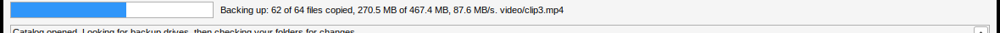
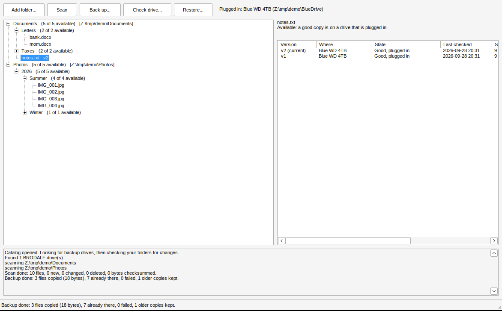
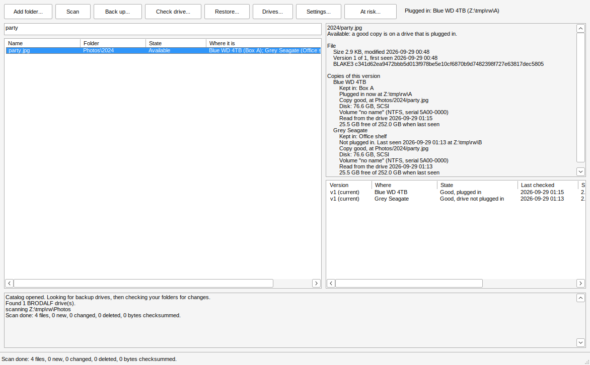
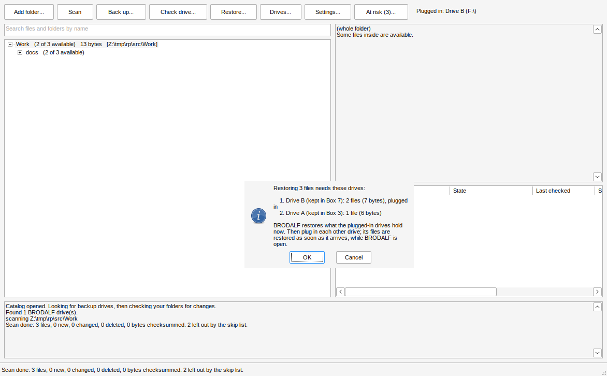

# BRODALF

BRODALF keeps track of where every copy of your files lives. It is built for
backups on hard drives that spend most of their time unplugged in a drawer.

The catalog, a `.brodalf` file, holds no file data. It records every file and
folder you protect, every version BRODALF has seen, and every drive a copy of
each version was written to. In the app, files stay greyed out until BRODALF
can see a correct copy on storage that is connected right now.

See [docs/DESIGN.md](docs/DESIGN.md) for the design.

## Status

Version **0.6.0**, released 2026-11-25. The C core library, the Windows app
(`brodalf.exe`) and a command-line harness (`brodalf-cli`) work, with
optional encryption. Builds are on the
[Releases](https://github.com/Phawx/BRODALF/releases) page: an installer that
needs no administrator rights, and a zip with the two exes. Both are
unsigned, so SmartScreen warns.

**0.6.0 takes out everything BRODALF used to start by itself**: it schedules
nothing, backs up and checks only when you press the button, and shows what a
backup will do before it starts (see [Nothing starts by itself](#nothing-starts-by-itself)).

**Everything new in 0.5.0 and 0.6.0 has only been built and tested off
Windows** (Linux tests; the MSVC build in CI). See
[Open items](#open-items-what-still-needs-trying-on-a-real-windows-pc). The Go files at the
top of the repo are the earlier prototype and are not part of the C build.

OneDrive and Dropbox storage was part of 0.3.0 and has been taken out for
now (see [Where the project stands](#where-the-project-stands)).

**0.3.0 was the first build tried on a real Windows PC** (2026-10-04): the
whole loop of scanning, backing up to a USB stick, checking, changing and
renaming files, keeping old versions and restoring worked first time. What
has still only run under Wine is listed under
[Where the project stands](#where-the-project-stands) at the end of this
file, with the open items and how to pick the work up.

## Build

You need CMake 3.16+ and a C compiler. Everything else is bundled in
`third_party/`.

```sh
cmake -S . -B build
cmake --build build --config Release
ctest --test-dir build -C Release
```

On Windows this works with Visual Studio (open the folder, or use the commands
above from a Developer Prompt) or MinGW-w64. To build a Windows `.exe` from
Linux:

```sh
cmake -S . -B build-win -DCMAKE_TOOLCHAIN_FILE=cmake/mingw-w64-x86_64.cmake
cmake --build build-win
```

## The Windows app


Run `brodalf.exe`, or double-click a `.brodalf` file after associating it.

1. Pick the last catalog, open another, or create a new one.
2. On a new catalog, choose the folders to protect.
3. BRODALF looks for the backup drives that are plugged in. It reads only
   the small `BRODALF.media` file on each to know which drive it is; nothing
   else starts until you press a button.
4. The tree shows everything you protect. Greyed files have no copy on a drive
   that is plugged in (the label says which drive holds them, if any). Amber
   files have changed, and only an older version is reachable. Red means a
   copy is missing or damaged, and struck-through means deleted from your
   folder. Folders show how many files inside are available.
5. Select a file to see every version and where each copy is.
6. **Scan folders** finds what changed in your folders. **Back up** shows what
   it will copy to a plugged-in drive and copies it when you press Start, or
   sets up a new drive. **Check drive** reads the copies on a drive (a quick
   look, a full read, or the copies not read lately). **Restore** writes the
   selected file or folder back out.

Clicking a file shows what it is (size, modified time, checksum, how many
versions) and every drive that holds it: the drive's name, where it is kept,
when and where it was last plugged in, and what the disk said about itself.
That works just the same when none of those drives are plugged in, so you know
which box to go and get.


The **Local backups** menu lists every external or removable disk BRODALF
knows, plugged in or not, with how much room it had when last seen; each
disk has a submenu to back up to it, run a quick check, read back its
copies, run a full check or see where it stands. Below the disks are **Add
an external or removable disk...**, **What needs backing up, and which disk
to plug in...**, **All disks...**, **Status of every disk...** and
**History...**.


Above the log, a progress bar shows what BRODALF is doing right now: how
many files it has looked at, copied or read back out of how many, how much
data, the current data rate and the file it is on.



After a backup, everything on the drive lights up:



### Encrypted drives

When you set up a new drive, tick **Encrypt the files on this drive**. The
first time, BRODALF asks you to choose a passphrase. File contents on that
drive are encrypted (XChaCha20-Poly1305, key from Argon2id), while file and
folder names stay readable so you can still find things in Explorer. Encrypted
copies end in `.bdenc`. Each drive is plain or encrypted from the day it is
set up.

Under **Settings...** you can change the passphrase, encrypt the catalog
file itself (BRODALF then asks for the passphrase when it opens), or make
BRODALF forget the passphrase until it next needs it.

**Write the passphrase down somewhere safe.** Without it, nobody can read the
encrypted copies, including you.


### Drives: identity, health and where they are kept

A drive is recognised by the `BRODALF.media` file on it, not by its letter.
Each time it is plugged in BRODALF also reads what the disk says about itself
and keeps the latest reading in the catalog:

- make, model, serial number, firmware, bus (USB, SATA, NVMe...) and size;
- the volume name, serial and file system;
- SMART health: the drive's own failure prediction, temperature, hours
  powered on, power cycles, reallocated/pending/unreadable sectors, and SSD
  wear. Internal SATA and NVMe drives answer without extra rights; some
  drives only answer when BRODALF runs as administrator, and many USB
  enclosures do not pass SMART through at all (BRODALF says which).

If the same drive ID ever turns up on a disk with a different serial number
(a copied or moved BRODALF folder), the log says so.

Every drive can also have a free-text **where it is kept** label, such as
"Label A" or "Box 3, garage shelf". Enter it when setting up a drive, or any
time from **Drives...**, which shows everything BRODALF knows about each
drive and lets you rename it.


### Files at risk

BRODALF has a protection target: by default **2 copies of every file, in 2
different places**. A place is what a drive's "where it is kept" says (so
"Box A" and "Office shelf" are two places), and drives with no place set
count together as one. A copy counts when BRODALF last saw it good, whether
or not the drive is plugged in right now.

The **At risk** button shows how many files fall short. It opens a list of
those files, fewest copies first (a file changed since its last backup has
no copy of its new version), and a list of the drives that would help most,
with where each is kept. Double-click a plugged-in drive, or pick it and
press **Back up to it**, to fill the gap. The target can be changed in the
same window.


### Nothing starts by itself

BRODALF does what you press, and only then. It schedules nothing, does not
back up or check a drive because it was plugged in, and does not care what
else runs on the PC. When it opens, or a drive is plugged in, it only reads
which BRODALF drives are present (their `BRODALF.media` file and free space)
so the tree can show what is reachable. Scanning your folders, backing up,
checking a drive and restoring each wait for their button, and the progress
bar shows where a running job is. Close BRODALF and nothing of it runs.

Earlier versions set up a daily check in Windows Task Scheduler. 0.6.0
removes that task the first time it opens the catalog, or when the task next
runs, whichever comes first.

### Before a backup: what it will do

**Back up** first shows what the backup will do on that drive: how many files
it copies and how much data, how many are new to it, how many changed (their
older copy is kept under `.versions`), how many were moved or renamed (moved
on the drive rather than copied again), how many old versions the keep rule
removes first, the free space, and whether it all fits. It also says when the
folders were last scanned, since a backup copies what that scan found;
**Scan the folders first, then back up** scans and shows the numbers again.
Nothing is written until you press **Start the backup**.

If a quarter or more of the files whose copies on that drive are up to date
(and at least 50) changed or were deleted since, the window warns that this
is what ransomware encrypting your files looks like, makes Cancel the
default, and ticks **Keep every old version on the drive this time**, so the
good copies stay under `.versions` even if you go ahead.

### Where each drive stands

**Drives...**, then a drive, shows where it stands, from the catalog alone,
so it works with the drive in a box: how many files are on it as they are
now, how many changed since (only an older version is on it), how many are
not on it at all, deleted files and older versions still kept on it, its
last backup (when, how it ended, how many files), its last check, copies
found missing or damaged, and copies never read back since they were
written. **Local backups > Status of every disk...** puts every drive in one
table. **History...** lists every scan, backup, restore and check you ran,
how it ended and how long it took. **Catalog > Export the file list
(CSV)...** writes every file, its size and date, and the drives holding it as
it is now, for a spreadsheet.

BRODALF records every drive's total and free space whenever it is plugged in
and before and after each backup. **Drives...** shows the latest reading, and
the **Free space** column of the at-risk view says whether what is at risk
would fit on each drive.

### Moved and renamed folders

Renaming or moving a folder used to mean copying all of it again. A scan
now recognises a file that disappeared in one place and turned up in
another by its checksum and size, and the next backup moves the copy on the
drive to the new name instead of copying it again. Folders that are left
empty on the drive go too. The backup window's warning about many changed
files also knows a move from damage, so renaming a big folder does not set
it off.

### Checking a drive

Checksums are what BRODALF trusts, not file names or dates. **Check drive**
offers three checks of a plugged-in drive:

- **Quick check**: is every copy there, at its size and time. Fast.
- **Full check**: reads every copy and compares its checksum.
- **Read back copies not read lately**: the copies not read back in a month,
  and new ones, so a full check can be spread over time. Change the month
  under **Settings > Check drive, Read back: which copies**.

A copy going bad on the shelf then shows up as damaged while you can still
replace it from your folder or another drive; the next backup to that drive
writes it again. BRODALF keeps track of when each drive's copies were last
read. When the oldest is more than 6 months old (**Settings > A drive is due
for a full check after**), the drive's details say so, and so does the log
when it is plugged in. It is a note, not a prompt.

**Catalog > Restore what is selected as it was on a date...** restores any
folder as it stood at the end of a chosen day, including files deleted
since, for when files were damaged or encrypted on the PC.

### Files in use

A file another program holds open, such as Outlook's `.pst` or a running
database, cannot be read, so a scan or backup skips it and lists it at the
end, with what to do: close that program and scan again. **Catalog > Files
that were in use at the last scan...** shows the list again. (0.5.0 could
read such files from a Windows shadow copy; 0.6.0 leaves that out, since
BRODALF no longer works around other programs.)

### Search

Type in the box above the tree to find files and folders by name anywhere
in your protected folders (every word must match, so `party 2024` works).
Each result shows whether it is available and which drives hold it, with
where each drive is kept, even when none of them are plugged in. Click a
result to see its details; double-click it to go to it in the tree.



### Restoring a folder spread across drives

When you restore a folder whose files live on several drives, BRODALF first
shows which drives it needs, in order, with where each one is kept:
"1. Drive B (kept in Box 7), plugged in; 2. Drive A (kept in Box 3)". It
restores what the plugged-in drives hold right away. Then plug in each other
drive and press **Restore...**, which offers to continue the waiting
restore with that drive's part.
Files already in the destination with the right size and contents are
skipped, so an interrupted restore just picks up where it stopped.



### When a drive fills up

A backup never fills a drive to the last byte (it leaves 16 MB, or 0.5% of
the drive, whichever is more). Files that don't fit are skipped and smaller
ones still go on. BRODALF then offers to put what didn't fit on another
plugged-in drive, or tells you to plug one in and press **Back up**; the
drive you choose then gets only the files the full drive(s) couldn't take, so a big folder spreads across as
many drives as it needs. The tree shows how much space each protected
folder needs next to its name.


### What to leave out

Scans skip temp files, caches and things a program can rebuild, such as
`*.tmp`, `~$*` Office lock files, `Thumbs.db`, `$RECYCLE.BIN`,
`node_modules`, `__pycache__` and `.cache`. Change the list under
**Settings > What to leave out...**: one pattern per line, `*` and `?` as
wildcards, a trailing `/` for folders only, and a `/` in the middle (like
`Photos/Exports/`) for a path inside a protected folder. Files that are
left out and were never backed up drop out of the tree; ones that were
backed up show as deleted, and their copies stay.

### Folders in OneDrive or Dropbox

A protected folder can be inside OneDrive or Dropbox (on many PCs Windows
keeps Documents and Pictures in OneDrive). Their files carry a Windows
marker that looks like a shortcut's; BRODALF tells the two apart and scans
them like any other file. A file that is "online-only" (in the cloud, not on
this PC) is left alone: BRODALF does not download it, says how many it left
in the scan summary, and backs it up once it is on the PC (open it, or
choose **Always keep on this device**). Real shortcuts
(symbolic links and junctions) are left out of scans.

### Old versions

When a file changes, the previous copy moves into `.versions` on the drive.
By default each drive keeps the last 5 old versions of a file, and every
old version from the past year; anything older than both is removed at the
start of the next backup to that drive. Pick another rule under
**Settings > Old versions on each drive** (keep everything, last 10 or past
year, last 3 or past 3 months, or only the version before the current one).
The current version is never removed.

### When something goes wrong

BRODALF keeps a log in `%LOCALAPPDATA%\BRODALF\brodalf.log` (the older
part moves to `brodalf.log.old` past about 1 MB). When a job stops with an
error, the catalog cannot be saved or opened, or the app crashes, BRODALF
shows the error and saves a report to
`%LOCALAPPDATA%\BRODALF\reports\brodalf-error-<date>-<time>.txt`. The
report starts with instructions for posting it as a new issue at
https://github.com/Phawx/BRODALF/issues, then gives the error, the BRODALF
version and build, the Windows version and the end of the log. Your user
name, computer name, email addresses and sign-in tokens are replaced before
the file is written. Nothing is sent anywhere. The command line does the
same, printing where the report went.

## Try it from the command line

```sh
brodalf-cli new   family.brodalf
brodalf-cli add   family.brodalf "C:\Users\me\Pictures"
brodalf-cli scan  family.brodalf
brodalf-cli tree  family.brodalf                      # everything greyed out
brodalf-cli drive family.brodalf E:\ "Blue WD 4TB"
brodalf-cli preview family.brodalf E:\                   # what a backup would do, doing none of it
brodalf-cli backup family.brodalf E:\
brodalf-cli tree  family.brodalf --drive E:\          # backed-up files light up
brodalf-cli versions family.brodalf Pictures "2024/IMG_0412.jpg" --drive E:\
brodalf-cli check family.brodalf E:\ --full
brodalf-cli restore family.brodalf D:\restored --drive E:\

brodalf-cli drive family.brodalf F:\ "Red Vault" --encrypt --location "Label A"
brodalf-cli drives family.brodalf                            # make, model, serial, health, where kept
brodalf-cli drive-location family.brodalf "Red Vault" "Box 3, garage"
brodalf-cli encrypt-catalog family.brodalf on
brodalf-cli passphrase family.brodalf                        # change it

brodalf-cli target  family.brodalf 2 2                       # 2 copies of everything, in 2 places
brodalf-cli at-risk family.brodalf                           # what falls short, and which drive to plug in
brodalf-cli search  family.brodalf party 2024                # find a file and the drive (and box) holding it
brodalf-cli option  family.brodalf check_days 365            # a drive is due for a full check after a year

brodalf-cli restore-plan family.brodalf --source Pictures --dest D:\restored   # which drives, in which order
brodalf-cli backup family.brodalf G:\ --continue-from "Blue WD 4TB"  # only what did not fit on the full drive
brodalf-cli skip    family.brodalf --add "Downloads/"         # leave a folder out of scans
brodalf-cli option  family.brodalf keep_versions 3           # keep the last 3 old versions ...
brodalf-cli option  family.brodalf keep_days 90              # ... and anything from the past 90 days
brodalf-cli prune   family.brodalf E:\                        # apply that now (backups also do it)

brodalf-cli need    family.brodalf                           # what needs backing up, and the drive to plug in
brodalf-cli verify  family.brodalf E:\                        # read back copies not read back in 30 days
brodalf-cli option  family.brodalf verify_days 7             # ... make that a week
brodalf-cli backup  family.brodalf E:\ --keep-old            # remove no old versions this time
brodalf-cli restore family.brodalf D:\restored --as-of 2026-09-30 --drive E:\    # the files as they were that day
brodalf-cli status  family.brodalf                           # where each drive stands
brodalf-cli history family.brodalf "Blue WD 4TB"             # what was run on that drive
brodalf-cli export  family.brodalf files.csv                 # every file and its drives, for a spreadsheet
```

The command line, like the app, starts nothing by itself: each command runs
once, when you run it. Ctrl+C stops a long one between files and keeps what
it finished.

Passphrases are asked for on the terminal, or read from `BRODALF_PASSPHRASE`
(and `BRODALF_NEW_PASSPHRASE` when setting one).

## Layout

| Path | What |
| --- | --- |
| `include/brodalf.h` | Public API of the core library |
| `src/catalog.c` | The `.brodalf` file format and schema |
| `src/scan.c` | Scanning source folders, versions, moves |
| `src/media.c` | Drive IDs, connecting drives, quick, full and read-back checks |
| `src/backup.c` | Backup with kept versions, restore |
| `src/crypto.c` | Passphrase, master key, encrypted file streams |
| `src/store*.c`, `src/store.h` | Storage interface: local drives and folders |
| `src/query.c` | Ghost-tree state for the GUI |
| `src/risk.c` | Files at risk, which drive would help, space tracking |
| `src/status.c` | Where each drive stands, job history, CSV export |
| `src/drive_hw.c` | Disk make, model, serial and SMART health |
| `src/platform_*.c` | Windows and POSIX file system layer |
| `gui/` | The Win32 app, `brodalf.exe` |
| `cli/main.c` | `brodalf-cli` |
| `tests/test_core.c` | End-to-end test |
| `tests/test_crypto.c` | Encryption test |

## Third-party code

`third_party/` holds unmodified copies of
[SQLite](https://sqlite.org) 3.45.0 (public domain),
[BLAKE3](https://github.com/BLAKE3-team/BLAKE3) 1.5.4 (CC0 / Apache-2.0) and
[zstd](https://github.com/facebook/zstd) 1.5.6 (BSD, single-file build) and
[Monocypher](https://monocypher.org) 4.0.2 (CC0 / BSD-2-Clause).

## Where the project stands

This section is the hand-off: everything a person or a Claude Code session
on a local machine needs to pick the work up without the chat history.

### History

- The original BRODALF was a Rust tool (egui GUI, catalog in SQLite, BLAKE3
  hashes, copies to a local folder). It no longer compiled and had no cold
  storage, no versioning and no cloud. It was used as a reference only; the
  Rust source is not in this repo.
- Before that there was a Go/Fyne prototype. Its files (`main.go`, `go.mod`,
  `go.sum`) still sit at the top of the repo, untouched, and are not built.
- On 2026-09-28 the design below was agreed and the C rewrite started
  (plain C11 + CMake, vendored dependencies). It landed as PR #1 the same
  day; everything since has gone straight to `master`.
- v0.2.0 was released 2026-09-29, v0.3.0 on 2026-10-04.
- On 2026-10-04 the released 0.3.0 was run on a real Windows 11 PC for the
  first time, against a USB stick; see
  [What the first real-PC test showed](#what-the-first-real-pc-test-showed).
- v0.4.0 (2026-10-07) took the OneDrive and Dropbox storage out again and
  fixed the four bugs below that the code review and that test turned up.
- v0.5.0 (2026-11-24): faster checksums (BLAKE3's SSE2/SSE4.1/AVX2/AVX-512
  paths), overlapped copies, hashing on several cores during a scan, fewer
  fsyncs; Stop for a running job; original modified times kept;
  case-insensitive paths on Windows (schema 6); every item of the
  2026-10-04 known-issues list fixed; backlog 1 to 6 built (recovery on a new
  PC, a recovery key, deleted files, replacing a drive, the recovery sheet,
  an installer); the scheduled check created through the Task Scheduler COM
  API so it runs on battery. None of it has run on a real Windows PC yet.
- v0.6.0 (2026-11-25): nothing starts by itself (owner's call, 2026-11-24).
  Taken out: the scheduled check (its task is removed), backing up and
  reading back when a drive is plugged in, the quick check on plug-in, the
  rescan on open, check reminders, a restore carrying on by itself, the
  ransomware guard and shadow copies. Added: a backup preview before Start
  (with a warning, and old versions kept, when many files changed at once),
  where each drive stands, a job history, a CSV export of the file list,
  online-only cloud files left alone, Ctrl+C in the command line.

### Design decisions (agreed 2026-09-28, still binding)

- **Not resident, and nothing automatic** (since 0.6.0, owner's call
  2026-11-24). BRODALF never runs in the background and schedules nothing.
  It does not care what else runs on the PC. Its point is keeping track of
  what has been backed up, and to where, from the original folders. The
  person chooses when to scan, back up, check and restore, and sees where
  each job and each drive stands. On open and on plug-in it only reads which
  drives are present. Free space per drive is recorded on plug-in and
  before and after every backup. A tray icon or always-on mode was rejected.
- **Checksums are the truth.** Whether data is safely held is decided by
  BLAKE3 checksums, everywhere: quick and full checks, read-back, move and
  rename detection.
- **Offline removable drives.** A drive is identified by the
  `BRODALF.media` file on it, never by its letter.
- **No cloud storage for now** (owner's call, 2026-10-07). OneDrive and
  Dropbox as secondary storage were built in 0.3.0 (OAuth with PKCE, tokens
  in Windows Credential Manager, app-folder access, chunked uploads) and
  removed in 0.4.0. The code is in git history at tag `v0.3.0`:
  `src/cloud.c`, `src/http_*.c`, `src/secrets.c`, `tests/test_cloud.c`,
  `tests/mock_cloud.py` and the cJSON dependency. A catalog written by
  0.3.0 that lists a cloud account still opens: the account is shown as
  unsupported, nothing can be backed up to it, and the copies it holds
  still count towards the protection target as a place of their own.
- **The catalog holds no file data**, only where the bits live. Old versions
  stay browsable on the drive in a `.versions` folder.
- **Encryption is optional**, per drive, and encrypts file contents only.
  File and folder names stay readable so a drive is still browsable.
- **Windows is the platform, the GUI is the interface**: native Win32 in C,
  with a Local backups menu listing every known disk and a prominent
  progress area. POSIX builds exist for tests and the CLI.
- **Startup flow**: open BRODALF, pick or create a `.brodalf` file, see which
  drives are plugged in, pick folders (a new catalog scans them), show the
  ghost tree greyed out until a copy is verified on connected storage.
  Clicking an entry shows its details in a second pane.
- **A copy of the catalog goes onto each drive** at the end of every backup
  to it (`catalog-backup.brodalf`).
- **Ransomware**: before a backup, warn about a mass change and keep the old
  versions, steering toward restoring, not backing up (the automatic pause
  of 0.3.0 to 0.5.0 was taken out in 0.6.0).

The original design write-up lives at
https://claude.ai/artifact/RMxcPVGY6unWn917nXnJ8w, but everything that
matters from it is in this section and in [docs/DESIGN.md](docs/DESIGN.md),
which describes the current implementation.

### How it is built and tested

- `cmake -S . -B build && cmake --build build && ctest --test-dir build`.
  Tests: `tests/test_core.c` (end to end, including the bit-rot and
  at-risk cases added in 0.4.0) and `tests/test_crypto.c` (about 50 s
  under ASan because of Argon2, 2 s in Release).
- CI is `.github/workflows/c-core.yml`: builds and tests on ubuntu-latest
  and windows-latest (MSVC), uploads `brodalf.exe` and `brodalf-cli.exe` as
  the `brodalf-windows` artifact.
- Until 0.3.0, Windows testing was done from Linux: cross-compile with
  `cmake/mingw-w64-x86_64.cmake` (`gcc-mingw-w64-x86-64`) and run under
  `wine64` with `LANG=C.UTF-8`; GUI screenshots were taken with Xvfb,
  xdotool and ImageMagick. Note that the released zip is the MSVC build
  from CI, not the MinGW build that ran under Wine. Wine has no VSS, a stub
  `schtasks`, no real disk model or SMART data and no real plug-in
  notifications.
- Vendored in `third_party/`: SQLite 3.45.0, BLAKE3 1.5.4 (with its SSE2,
  SSE4.1, AVX2 and AVX-512 C files since 0.5.0), zstd 1.5.6
  (single file) and Monocypher 4.0.2. Nothing is downloaded at build time.

### Releasing

CI publishes a release on every push to `master` whose `project(... VERSION
x.y.z)` in `CMakeLists.txt` has no release yet, as `vx.y.z`, with the zip of
the two exes plus this README and THIRD-PARTY-NOTICES.txt, the NSIS installer
built from `installer/brodalf.nsi`, and the notes from
`.github/release-notes.md`.
To ship: bump the version in `CMakeLists.txt`, update the release notes,
push to `master`. The exes are unsigned.

### What the first real-PC test showed

On 2026-10-04 the released 0.3.0 was run on a Windows 11 laptop with a
29 GB SanDisk USB stick (FAT32) as the drive, the protected folder inside
OneDrive, 13 bogus files (5.6 MB) with a `.tmp`, an empty file, a one-byte
file and an accented name among them. Everything in the loop worked first
time and no error report was produced:

- scan (12 files, the `.tmp` left out, nothing skipped as a link);
- setting up the drive and backing up (12 copies, all identical to the
  originals by SHA-256; `BRODALF.media` and `catalog-backup.brodalf` on
  the stick);
- the file details and **Drives...** with the real hardware: make, model,
  serial, firmware, bus, volume, free space and the "does not pass SMART
  through" note;
- a full check (12 good); editing, renaming and removing files, then
  backing up again (the old version under `.versions`, the renamed file
  moved on the drive instead of copied, the removed file kept);
- restoring the folder (identical to the source);
- the **At risk** window; closing (catalog saved, lock released).

Also seen: creating a catalog registers the Task Scheduler job straight
away (`schtasks /Create ... -> 0` in the log), and the first launch had
been left at the catalog chooser while a second was started, so two
instances ran at once (the lock file kept them apart). The four bugs fixed
in 0.4.0 came from the code review of the same day and this test:

1. OneDrive and Dropbox placeholder files carry the reparse-point
   attribute, and the scanner treated every reparse point as a link to
   skip (`src/platform_win32.c`). It did not bite in the test because the
   files were freshly created, but a synced folder could have gone
   entirely unprotected. Only name-surrogate reparse points (symbolic
   links, junctions) are links now.
2. A copy found damaged by a full check was marked good again by the next
   quick check when its size and time had not changed, which is what bit
   rot looks like (`src/media.c`). A copy found missing or damaged now
   stays so until a re-read matches its hash.
3. The shadow-copy helper (`brodalf.exe --shadow-copy`) was started after
   the GUI's `CoInitializeEx(COINIT_APARTMENTTHREADED)`, so VSS ran in a
   single-threaded apartment with a blocking wait, the classic hang. The
   helper now runs before COM is initialised (`gui/main.c`).
4. The **At risk** list said "changed since its last backup" for a file
   whose newest version was already backed up (`src/risk.c`).

### Open items: what still needs trying on a real Windows PC

1. Upgrading from 0.5.0: the old daily task in Task Scheduler ("BRODALF -
   <catalog file>") should be gone after the catalog is opened once, and a
   task that fires before that should remove itself and show nothing.
2. Plugging in a known disk while BRODALF is open: the device-change
   notification should only add a line to the log ("... is plugged in") and
   light up its files; nothing else should start. The test had the stick
   plugged in before launch, so this never fired.
3. Everything new in 0.6.0: the backup window (its numbers against what the
   backup then does, Scan first, the mass-change warning and its tick box),
   Check drive's three choices, the drive's "Where it stands", Status of
   every disk, History, the CSV export opened in Excel (the accented names,
   the leading-quote guard against formulas), continuing a waiting restore
   from Restore..., and OneDrive online-only files left alone.
4. **Drives...** with internal disks: SMART from NVMe and SATA, the admin
   fallback (whose reading is currently replaced by the next unprivileged
   one), and RAID-mode laptops. The USB stick path is confirmed. Since 0.5.0
   the temperature comes from property 52 and the ATA table is only read
   from ATA disks.
5. Everything new in 0.5.0, none of which has run on Windows:
   - speed: the AVX2/AVX-512 paths in the MSVC build, the copy writer
     thread, and how much the scan pool and batched fsyncs gain on real
     disks (spinning disks especially; `NtFlushBuffersFileEx(NO_SYNC)` on
     NTFS, FAT32 and exFAT);
   - Stop while a job runs, and Close during a job and during end-of-job
     questions;
   - modified times on copies and restores (NTFS, FAT32, exFAT);
   - a case-only rename (Photo.JPG to photo.jpg) on NTFS and exFAT;
   - a second BRODALF on the same catalog is refused, and the catalog opens
     again after a crash (named mutex);
   - Recover from a backup drive on a second PC, Replace this drive, the
     recovery sheet in a browser and printed, unlocking with the recovery
     key, the deleted-files view;
   - the installer: install, Start menu entry, uninstall, the Installed apps
     entry.

### Known issues

Everything on the 2026-10-04 code-review list was fixed in 0.5.0. Known
limits of the new work:

- **Replace this drive** copies onto the new drive only what is still in the
  source folders. Deleted files and older versions held only on the old
  drive are counted and the user is told to keep the old drive; they are not
  copied drive to drive.
- 0.6.0 leaves out three of the picks offered for it, for now: reading each
  copy back straight after writing it (Windows would usually serve the read
  from its cache, so it would not prove the drive holds the data; Check
  drive's read back does), adopting a drive that already holds copies made
  another way, and copying from drive to drive. Each needs bigger changes
  to the catalog and matching than could be tested here.
- `brodalf-cli` errors that end the program (`die()`) do not save the
  catalog; Ctrl+C does.
- 0.4.0 and earlier refuse an encrypted catalog that has a recovery key, as
  a newer format.
- Case-insensitive matching keys (`nodes.rel_fold`) are only written by
  Windows builds, so files added to a catalog by a POSIX build have none.

### Backlog: suggested but not yet asked for

Ideas offered to the owner and not picked up. Pick by number.

1. ~~Recovery on a new PC~~ (0.5.0).
2. ~~A printable recovery key for the encryption passphrase~~ (0.5.0).
3. ~~A deleted-files view~~ (0.5.0).
4. ~~Replace a drive~~ (0.5.0; see the known limits).
5. ~~A printable drive list~~ (0.5.0, with the recovery key on one sheet).
6. ~~An installer~~ (0.5.0, NSIS, per user).
7. Code signing (needs a paid certificate), so SmartScreen stops warning.
8. An update check.
9. Cloud storage again (OneDrive, Dropbox), starting from the 0.3.0 code
   in git history. Before bringing it back: a Microsoft Entra app
   registration, listing-based quick checks instead of one request per
   copy, local `quickXorHash` and Dropbox `content_hash` so uploads are
   verified, and resumable chunked uploads.

Rejected: a tray icon or always-on mode, and (since 0.6.0) anything that
starts by itself: scheduled checks, backups or checks on plug-in, reminders.

### Working conventions

- Commit straight to `master`; no long-lived branches, no PRs needed.
  Build and run the tests before pushing and keep CI green.
- Bump the version and ship a release when a batch of work is done.
- Write user-facing text (menus, dialogs, this README) in plain language,
  no jargon; the user of the app is not a developer.
- Say plainly in notes and release text what has only been exercised under
  Wine.
